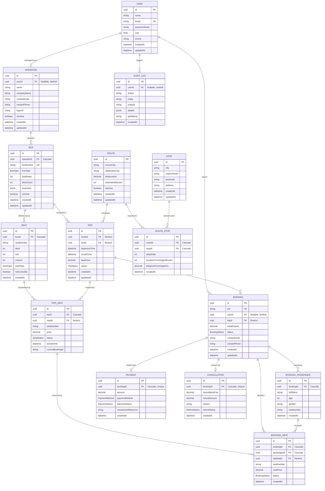
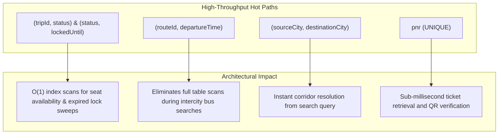

# Database Architecture & Entity-Relationship (ER) Specification

**Platform:** GoBus - Intercity Bus Booking Platform  
**Architecture:** High-Throughput Relational Transit Data Model  
**Database Engine:** PostgreSQL 16+  
**ORM & Migration Framework:** Prisma ORM Client 6.x  
**Data Integrity Paradigm:** ACID-compliant Relational Architecture with Pessimistic Row-Level Locking (`SELECT ... FOR UPDATE`)

---

## 1. High-Level Entity-Relationship (ER) Diagram

The following Mermaid diagram models the entire relational topology of the GoBus platform, including all 15 core entities, their cardinalities, foreign key dependencies, and enum associations.

---

## 2. Comprehensive Data Dictionaries

### 2.1 Enums

| Enum Name | Defined Literals | Domain / Usage |
|---|---|---|
| `Role` | `ADMIN`, `OPERATOR`, `PASSENGER` | Granular role-based access control (RBAC). |
| `BusType` | `AC_SLEEPER_2X1`, `AC_SEATER_2X2`, `NON_AC_SEATER_2X2` | Fleet categorization and seat-map rendering driver. |
| `SeatType` | `WINDOW`, `AISLE`, `MIDDLE`, `SLEEPER` | Physical seat attribution and passenger ergonomics. |
| `TripStatus` | `SCHEDULED`, `RUNNING`, `COMPLETED`, `CANCELLED` | Operational trip execution lifecycle. |
| `SeatStatus` | `AVAILABLE`, `LOCKED`, `BOOKED` | Concurrency state machine for individual seats. |
| `BookingStatus` | `CONFIRMED`, `CANCELLED` | High-level passenger reservation lifecycle. |
| `PaymentMethod` | `UPI`, `NET_BANKING`, `DEBIT_CARD`, `CREDIT_CARD`, `WALLET` | Multi-channel payment gateway support. |
| `PaymentStatus` | `SUCCESS`, `REFUNDED` | Financial settlement verification status. |
| `RefundStatus` | `PROCESSED` | Automated cancellation refund audit state. |

---

### 2.2 Core Schema Entities

#### A. `User`
Stores authenticated platform accounts (Passengers, Bus Fleet Operators, and Platform Administrators).

| Field | Type | Nullable | Default | Constraints / Foreign Keys | Description |
|---|---|---|---|---|---|
| `id` | `UUID` | No | `gen_random_uuid()` | **PK** | Unique identifier |
| `name` | `VARCHAR(255)` | No | — | — | Full legal or display name |
| `email` | `VARCHAR(255)` | No | — | **UNIQUE**, Index | Login identity and notification target |
| `passwordHash` | `VARCHAR(255)` | No | — | — | BCrypt password hash (salt rounds: 10) |
| `role` | `Role` | No | `'PASSENGER'` | Index | Security authorization role |
| `phone` | `VARCHAR(32)` | Yes | `NULL` | — | Contact phone number |
| `createdAt` | `TIMESTAMPTZ` | No | `now()` | — | Record creation timestamp |
| `updatedAt` | `TIMESTAMPTZ` | No | Auto | — | Last update timestamp |

---

#### B. `Operator`
Profiles verified bus fleet companies operating under GoBus.

| Field | Type | Nullable | Default | Constraints / Foreign Keys | Description |
|---|---|---|---|---|---|
| `id` | `UUID` | No | `gen_random_uuid()` | **PK** | Unique operator identifier |
| `userId` | `UUID` | Yes | `NULL` | **UNIQUE**, FK `User(id)` OnDelete `SetNull` | Optional linked operator user |
| `name` | `VARCHAR(255)` | No | — | — | Registered representative name |
| `companyName` | `VARCHAR(255)` | No | — | — | Fleet brand name (e.g., Zingbus Express) |
| `contactEmail` | `VARCHAR(255)` | No | — | — | Support and operations email |
| `contactPhone` | `VARCHAR(32)` | No | — | — | Operational hotline |
| `logoUrl` | `VARCHAR(512)` | Yes | `NULL` | — | Brand logo asset URI |
| `isActive` | `BOOLEAN` | No | `true` | — | Fleet activation toggle |
| `createdAt` | `TIMESTAMPTZ` | No | `now()` | — | Registration timestamp |
| `updatedAt` | `TIMESTAMPTZ` | No | Auto | — | Modification timestamp |

---

#### C. `Bus`
Physical coach asset specification, dimensions, and operator ownership.

| Field | Type | Nullable | Default | Constraints / Foreign Keys | Description |
|---|---|---|---|---|---|
| `id` | `UUID` | No | `gen_random_uuid()` | **PK** | Unique bus identifier |
| `operatorId` | `UUID` | No | — | FK `Operator(id)` OnDelete `Cascade`, Index | Fleet owner |
| `busNumber` | `VARCHAR(64)` | No | — | **UNIQUE** | Registration plate (e.g. `DL01SL2026`) |
| `busType` | `BusType` | No | `'AC_SEATER_2X2'` | Index | Seating configuration category |
| `totalSeats` | `INT` | No | — | — | Total physical seat capacity |
| `deckCount` | `INT` | No | `1` | — | 1 for single deck, 2 for double-decker sleeper |
| `amenities` | `JSONB` | Yes | `NULL` | — | Wi-Fi, Charging, Water, Blanket, etc. |
| `isActive` | `BOOLEAN` | No | `true` | — | In-service fleet availability |
| `createdAt` | `TIMESTAMPTZ` | No | `now()` | — | Registration date |
| `updatedAt` | `TIMESTAMPTZ` | No | Auto | — | Update timestamp |

---

#### D. `Seat`
Static physical seat layout definition for a specific coach.

| Field | Type | Nullable | Default | Constraints / Foreign Keys | Description |
|---|---|---|---|---|---|
| `id` | `UUID` | No | `gen_random_uuid()` | **PK** | Unique seat layout identifier |
| `busId` | `UUID` | No | — | FK `Bus(id)` OnDelete `Cascade`, Index | Parent bus asset |
| `seatNumber` | `VARCHAR(16)` | No | — | Composite Unique (`busId`, `seatNumber`) | Seat code (e.g. `1A`, `L1A`, `U2B`) |
| `deck` | `INT` | No | `1` | — | 1 = Lower Deck, 2 = Upper Deck |
| `row` | `INT` | No | — | — | Grid row coordinate |
| `column` | `INT` | No | — | — | Grid column coordinate |
| `seatType` | `SeatType` | No | `'WINDOW'` | — | Window, Aisle, Middle, or Sleeper |
| `isAccessible` | `BOOLEAN` | No | `false` | — | Specially-abled / senior citizen designated |
| `createdAt` | `TIMESTAMPTZ` | No | `now()` | — | Creation timestamp |

---

#### E. `Route`
High-level origin-destination intercity corridor.

| Field | Type | Nullable | Default | Constraints / Foreign Keys | Description |
|---|---|---|---|---|---|
| `id` | `UUID` | No | `gen_random_uuid()` | **PK** | Unique route corridor identifier |
| `sourceCity` | `VARCHAR(128)` | No | — | Composite Unique (`sourceCity`, `destinationCity`), Composite Index | Origin terminal city (e.g., Delhi) |
| `destinationCity`| `VARCHAR(128)` | No | — | Composite Unique (`sourceCity`, `destinationCity`), Composite Index | Destination city (e.g., Manali) |
| `distanceKm` | `DECIMAL(8,2)` | No | — | — | Total road distance |
| `estimatedMinutes`| `INT` | No | — | — | Estimated travel time in minutes |
| `isActive` | `BOOLEAN` | No | `true` | — | Route operational status |
| `createdAt` | `TIMESTAMPTZ` | No | `now()` | — | Route creation timestamp |
| `updatedAt` | `TIMESTAMPTZ` | No | Auto | — | Route update timestamp |

---

#### F. `Stop` & `RouteStop`
Physical boarding/drop stations and their ordered sequences along a route.

**Stop:**
- `id` (PK, UUID)
- `city` (VARCHAR(128), Indexed)
- `stationName` (VARCHAR(255))
- `landmark` (VARCHAR(255), Nullable)
- `address` (TEXT, Nullable)

**RouteStop (Junction Table):**
- `id` (PK, UUID)
- `routeId` (FK `Route(id)` OnDelete `Cascade`, Indexed)
- `stopId` (FK `Stop(id)` OnDelete `Cascade`, Indexed)
- `stopOrder` (INT, Composite Unique with `routeId`)
- `durationFromOriginMinutes` (INT)
- `distanceFromOriginKm` (DECIMAL(8,2))

---

#### G. `Trip`
A scheduled departure of a specific bus along a designated route.

| Field | Type | Nullable | Default | Constraints / Foreign Keys | Description |
|---|---|---|---|---|---|
| `id` | `UUID` | No | `gen_random_uuid()` | **PK** | Scheduled trip identifier |
| `routeId` | `UUID` | No | — | FK `Route(id)` OnDelete `Restrict`, Composite Index (`routeId`, `departureTime`) | Route assigned |
| `busId` | `UUID` | No | — | FK `Bus(id)` OnDelete `Restrict`, Index | Physical bus assigned |
| `departureTime`| `TIMESTAMPTZ` | No | — | Composite Index (`routeId`, `departureTime`) | Scheduled departure |
| `arrivalTime` | `TIMESTAMPTZ` | No | — | — | Scheduled arrival |
| `baseFare` | `DECIMAL(10,2)`| No | — | — | Baseline ticket price in INR |
| `status` | `TripStatus` | No | `'SCHEDULED'` | Index | Lifecycle state |
| `createdAt` | `TIMESTAMPTZ` | No | `now()` | — | Creation timestamp |
| `updatedAt` | `TIMESTAMPTZ` | No | Auto | — | Update timestamp |

---

#### H. `TripSeat` (Core Concurrency Unit)
Instantiated per-trip seat inventory, protected by pessimistic row locks.

| Field | Type | Nullable | Default | Constraints / Foreign Keys | Description |
|---|---|---|---|---|---|
| `id` | `UUID` | No | `gen_random_uuid()` | **PK** | Trip seat inventory identifier |
| `tripId` | `UUID` | No | — | FK `Trip(id)` OnDelete `Cascade`, Composite Unique (`tripId`, `seatNumber`), Composite Unique (`tripId`, `seatId`), Composite Index (`tripId`, `status`) | Parent scheduled trip |
| `seatId` | `UUID` | No | — | FK `Seat(id)` OnDelete `Restrict` | Static seat geometry definition |
| `seatNumber` | `VARCHAR(16)` | No | — | Composite Unique with `tripId` | Seat code (e.g. `1A`) |
| `price` | `DECIMAL(10,2)`| No | — | — | Dynamic/effective seat fare |
| `status` | `SeatStatus` | No | `'AVAILABLE'` | Composite Index (`tripId`, `status`), Composite Index (`status`, `lockedUntil`) | State machine flag |
| `lockedUntil` | `TIMESTAMPTZ` | Yes | `NULL` | Composite Index (`status`, `lockedUntil`) | 10-minute hold deadline |
| `currentBookingId`| `VARCHAR(64)`| Yes | `NULL` | — | Current lock session or confirmed booking UUID |

---

#### I. `Booking`, `BookingPassenger` & `BookingSeat`
Transactional passenger reservation and passenger manifest records.

**Booking:**
- `id` (PK, UUID)
- `pnr` (VARCHAR(16), **UNIQUE**, Indexed) — Human-readable format: `GB-XXXXXX` (e.g. `GB-K7M2P9`)
- `userId` (FK `User(id)` OnDelete `SetNull`, Indexed, Nullable)
- `tripId` (FK `Trip(id)` OnDelete `Restrict`, Indexed)
- `totalAmount` (DECIMAL(10,2))
- `status` (BookingStatus: `CONFIRMED`, `CANCELLED`, Indexed)
- `contactEmail` (VARCHAR(255))
- `contactPhone` (VARCHAR(32))
- `createdAt` (TIMESTAMPTZ, Indexed)
- `updatedAt` (TIMESTAMPTZ)

**BookingPassenger:**
- `id` (PK, UUID)
- `bookingId` (FK `Booking(id)` OnDelete `Cascade`, Indexed)
- `fullName` (VARCHAR(255))
- `age` (INT)
- `gender` (VARCHAR(16))
- `seatNumber` (VARCHAR(16))

**BookingSeat (Junction / Audit Table):**
- `id` (PK, UUID)
- `bookingId` (FK `Booking(id)` OnDelete `Cascade`, Indexed)
- `passengerId` (FK `BookingPassenger(id)` OnDelete `Cascade`, Indexed)
- `tripSeatId` (FK `TripSeat(id)` OnDelete `Restrict`, Indexed)
- `seatNumber` (VARCHAR(16))
- `seatPrice` (DECIMAL(10,2))
- `status` (BookingStatus: `CONFIRMED`, `CANCELLED`, Indexed)

---

#### J. `Payment` & `Cancellation`
Financial ledger records guaranteeing immutability and auditing.

**Payment:**
- `id` (PK, UUID)
- `bookingId` (FK `Booking(id)` OnDelete `Cascade`, **UNIQUE**)
- `amount` (DECIMAL(10,2))
- `paymentMethod` (PaymentMethod: `UPI`, `NET_BANKING`, etc.)
- `paymentStatus` (PaymentStatus: `SUCCESS`, `REFUNDED`, Indexed)
- `transactionReference` (VARCHAR(128)) — e.g. `TXN-UPI-1731456000000-A8B9`
- `createdAt` (TIMESTAMPTZ, Indexed)

**Cancellation:**
- `id` (PK, UUID)
- `bookingId` (FK `Booking(id)` OnDelete `Cascade`, **UNIQUE**)
- `cancellationFee` (DECIMAL(10,2))
- `refundAmount` (DECIMAL(10,2))
- `reason` (TEXT)
- `refundStatus` (RefundStatus: `PROCESSED`)
- `createdAt` (TIMESTAMPTZ, Indexed)

---

#### K. `AuditLog`
Append-only system security and operational action log.

- `id` (PK, UUID)
- `userId` (FK `User(id)` OnDelete `SetNull`, Indexed, Nullable)
- `action` (VARCHAR(64)) — e.g., `AUTH_LOGIN`, `SEAT_LOCKED`, `BOOKING_CREATED`, `BOOKING_CANCELLED`
- `entity` (VARCHAR(64), Composite Index `(entity, entityId)`)
- `entityId` (VARCHAR(64), Composite Index `(entity, entityId)`)
- `details` (JSONB) — Full request payload, status diffs, financial charges
- `ipAddress` (VARCHAR(64), Nullable)
- `createdAt` (TIMESTAMPTZ, Indexed)

---

## 3. Indexing Strategy & Performance Rationale

1. **`TripSeat(tripId, status)` & `TripSeat(status, lockedUntil)`**:
   - Critical for seat-map rendering and concurrent booking lock validation.
   - Enables background workers or lazy sweeps to prune expired locks (`status = 'LOCKED' AND lockedUntil < NOW()`) via index range scan without locking uncontested rows.

2. **`Route(sourceCity, destinationCity)`**:
   - Unique composite index enforces corridor integrity and accelerates search queries `WHERE sourceCity = $1 AND destinationCity = $2` to index lookups.

3. **`Trip(routeId, departureTime)`**:
   - Supports date-bounded corridor queries (`departureTime >= $1 AND departureTime <= $2`) ordered by departure timestamp.

4. **`Booking(pnr)`**:
   - Unique B-Tree index guarantees $O(1)$ ticket lookup by PNR across passenger portals, mobile check-ins, and conductor scanners.

5. **`AuditLog(entity, entityId)` & `AuditLog(createdAt)`**:
   - Accelerates audit trail queries for specific bookings or operators during compliance and debugging reviews.

---

## 4. Cardinality & Referential Integrity Matrix

| Parent Entity | Child Entity | Cardinality | Foreign Key | OnDelete Behavior | Integrity Guarantee |
|---|---|---|---|---|---|
| `User` | `Operator` | `1 : 0..1` | `Operator.userId` | `SetNull` | Operator record preserved if managing user account is decoupled. |
| `User` | `Booking` | `1 : 0..N` | `Booking.userId` | `SetNull` | Historical bookings and financial records remain intact if user requests account deletion. |
| `Operator` | `Bus` | `1 : 1..N` | `Bus.operatorId` | `Cascade` | Fleet records purge when an operator is deregistered. |
| `Bus` | `Seat` | `1 : 1..N` | `Seat.busId` | `Cascade` | Physical seat templates delete cleanly with bus asset. |
| `Bus` | `Trip` | `1 : 0..N` | `Trip.busId` | `Restrict` | Bus cannot be deleted while assigned to scheduled or running trips. |
| `Route` | `Trip` | `1 : 0..N` | `Trip.routeId` | `Restrict` | Route corridor cannot be deleted while active trips depend on it. |
| `Route` | `RouteStop` | `1 : 1..N` | `RouteStop.routeId` | `Cascade` | Route stops are managed as an atomic unit with the route. |
| `Trip` | `TripSeat` | `1 : 1..N` | `TripSeat.tripId` | `Cascade` | Seat inventory lifecycle is strictly bound to trip lifecycle. |
| `Trip` | `Booking` | `1 : 0..N` | `Booking.tripId` | `Restrict` | Trips with active bookings cannot be deleted accidentally. |
| `Booking` | `BookingPassenger`| `1 : 1..N` | `BookingPassenger.bookingId` | `Cascade` | Passenger manifests are owned by the booking transaction. |
| `Booking` | `BookingSeat` | `1 : 1..N` | `BookingSeat.bookingId` | `Cascade` | Seat allocations are owned by the booking transaction. |
| `Booking` | `Payment` | `1 : 1` | `Payment.bookingId` | `Cascade` | Financial payment transaction is tied 1:1 to booking. |
| `Booking` | `Cancellation` | `1 : 0..1` | `Cancellation.bookingId` | `Cascade` | Cancellation refund audit record linked 1:1 with booking. |

